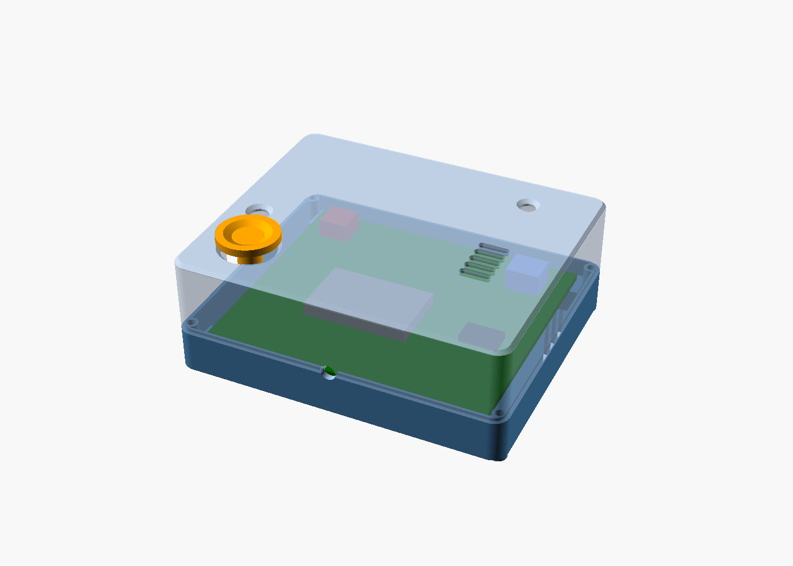

# ESP32 multiple-IO case

3D-printable case for the 75 x 64 mm PCB in
`../pcb/source/Gerber_ESP32-multiple-IO_PCB_20210624_2026-11-02.zip`.

## Files

| File | Purpose |
|---|---|
| `esp32_case.scad` | Parametric OpenSCAD source |
| `esp32_case_base.stl` | Standard base tray, print as oriented |
| `esp32_case_base_501.stl` | Base with front-right HC-SR501 bay |
| `esp32_case_base_ext.stl` | Standard base + 30 mm front cable extension |
| `esp32_case_base_501_ext.stl` | HC-SR501 base + 30 mm front cable extension |
| `esp32_case_lid.stl` | Standard lid, print as oriented |
| `esp32_case_lid_501.stl` | HC-SR501 lid (standard lid, no mini-PIR window) |
| `esp32_case_lid_ext.stl` | Standard lid + 30 mm front cable extension |
| `esp32_case_lid_501_ext.stl` | HC-SR501 lid + 30 mm front cable extension |
| `esp32_case_lid_pir_ext.stl` | Mini-PIR lid + 30 mm front cable extension |
| `esp32_case_pir501_cover.stl` | Removable ceiling/cover for the HC-SR501 bay |
| `esp32_case_lid_pir.stl` | Lid with 13 x 13.4 mm mini-PIR window |
| `esp32_case_plunger.stl` | Optional KEY1 button cap |
| `esp32_case_preview.png` | Standard case preview with PCB mock-up |
| `esp32_case_lid_preview.png` | Lid openings / rim view |
| `esp32_case_pir_preview.png` | Mini-PIR lid preview |
| `esp32_case_501_preview.png` | HC-SR501 base preview |
| `esp32_case_ext_preview.png` | Standard +30 mm extension preview |
| `esp32_case_501_ext_preview.png` | HC-SR501 +30 mm extension preview |

## Dimensions

- Standard case: **86.8 x 71.8 x 32.3 mm**
- Standard +30 mm extension: **86.8 x 101.8 x 32.3 mm**
- HC-SR501 version: **87.4 x 98.4 x 32.3 mm** (bay included)
- HC-SR501 +30 mm extension: **87.4 x 128.4 x 32.3 mm**
- PCB position: bottom at **z = 8.1 mm**
- Bottom clearance: **6.5 mm** (PCB bottom to inner floor)
- Top clearance: **21 mm** (20 mm requested + 1 mm margin)
- PCB: 75 x 64 x 1.6 mm, **4.2 mm side clearance** (2.2 mm front/back); the
  lid-screw bosses clear the PCB edge by 1.6 mm
- Width increased **2 mm on each side** (4 mm total) compared with the
  previous version; the PCB and board screws stay at their original positions.
- Board screws: **4x M2 x 8 mm**, 1.85 mm pilot holes 6.5 mm deep with a
  2.25 mm lead-in, in 8 x 8 mm corner bosses
- Lid joint: **external rabbet, base inner lip raised**. The base rim has a
  1.0 mm wide outer shelf lowered by 0.8 mm; the remaining inner lip stays at
  full height. The lid has an 0.8 mm thick outer skirt that sits on the shelf,
  while the lid inner wall sits on the raised base lip. The skirt runs 0.2 mm
  clear of the base lip. The outer surfaces are flush; the visible seam is the
  bottom edge of the lid skirt.
- Plus **4x M2x20 lid screws** inserted from under the base on all versions.
  Heads recessed, lid top clean; the four screws are at the corners, **2.4 mm
  from the side walls and 3.55 mm from the front/back walls** (x = -0.4 /
  81.6 mm; y = 2.75 / 67.45 mm standard, -27.25 / 67.45 mm +30). Their bosses
  clear the PCB edge by 1.6 mm. The base posts run full height from the floor
  to the rim, beside the PCB corner bosses. Local bottom pads keep the recessed
  heads supported at the chamfer.
- Walls / floor / lid top: **1.6 mm**
- External corners: **R4**, top/bottom outer edges chamfered **1 mm**

The PCB sits at z = 8.1 mm so the M2x8 screw has about 5.6 mm of engagement
after the lead-in, without breaking through the case floor.

## Front-extended version (+30 mm)

The `*_ext.stl` files add **30 mm** in the U3/USB cable direction (the front).
The PCB and the four screw bosses stay at their original positions; the extra
length is an empty cable compartment in front of the board.

- **USB hole:** moves to the new front wall.
- **PHR / VACG / KEY1 / MIC openings:** stay over the board; the lid top over
  the extension is solid.
- **HC-SR501 bay:** moves to the new front wall; the PIR cable is 30 mm longer.
- **Mini PIR window:** moves to the new front wall; mount the mini PIR at the
  new front.
- **Screws:** unchanged, 4x M2 x 8 mm in the original boss positions.
- The HC-SR501 cover is the same `esp32_case_pir501_cover.stl`.
- In `esp32_case.scad`, the extension is `front_ext` (default 0); export with
  `-D front_ext=30`.

## Printing

- PLA or PETG. PETG is better for outdoor/UV use.
- 0.2 mm layers, 3 perimeters, 20–30 % infill.
- **Base:** print as oriented, open side up. No supports.
- **Base 501:** print as oriented; the PIR bay is open at the top. No supports.
- **Lid:** print as oriented. The STL is already flipped so the top face is on
  the bed and the open side is up. No supports.
- **Plunger:** print as oriented, base plate on the bed. No supports.

## Assembly

1. Put the PCB on the four corner bosses.
2. Fit **4x M2x8 self-tapping pan-head screws** through the PCB holes into the
   base pilots. Do not overtighten.
3. If using the KEY1 plunger, insert it from above through the 14 mm lid hole
   before fitting the lid. The 13 mm base plate rests on the switch; the 16 mm
   cap stays above the lid.
4. Press the lid on; the lid outer skirt drops onto the base shelf and the lid
   inner wall seats on the raised base lip.
5. Insert the **M2x20 lid screws** from under the base into the lid posts and
   tighten. The heads sit in the bottom counterbores.
6. To open, remove the lid screws, then pry gently at the PHR side window, the
   USB hole, or the VACG side vents.

The PCB mounting holes are 2.032 mm, so M2 screws pass through. If the printed
case pilots are still tight, drill them to 2.2 mm. If they are too loose, a
drop of CA glue or an M2 heat-set insert will restore the grip. If the PCB
holes are tight, ream them to about 2.2 mm. If the lid is loose, add a strip of
tape to the lid skirt; if it is tight, sand the skirt lightly.

## Openings

| Component | Opening |
|---|---|
| **KEY1** | 14 mm top opening + optional plunger |
| **PHR** | 5 mm top light hole + 12 x 10 mm left-side window (lid-only, from the seam) |
| **MIC1** | 4 mm top sound hole |
| **VACG1 … VCAG2** | 5x 8 x 2 mm top slots + 3x 3 x 10 mm right-side slots (lid-only, starting at the seam) |
| **USB / U3 wire** | 4 mm hole in the front wall, split between base and lid |
| **Mini PIR (optional)** | 13 x 13.4 mm front window, `esp32_case_lid_pir.stl` |
| **HC-SR501 (optional)** | 25 mm lens hole in the `base_501` front bay + removable cover |

The USB hole is sized for a **3.2 mm cable**, not a USB plug. It is centred at
`x = 39.44 mm` on the U3/USB centreline and is split at the base/lid seam.

The VACG side vents are entirely in the lid and start at the base/lid seam.
The base wall below is solid, so there is no lower extension or seam line
across the ventilation openings.

## PIR options

### Mini PIR — AM312 / HC-SR505

- Use `esp32_case_lid_pir.stl` with the standard base.
- The lid has a **13 x 13.4 mm** window in the front wall at
  `x = 18…31 mm`, `z = 12.7…26.1 mm`.
- Mount the mini PIR inside the front-left corner with its lens facing the
  window.
- Cover the window with **1 mm HDPE/PE film** (IR-transparent). PLA is not
  IR-transparent; an open hole works but lets dust in.

### HC-SR501

- Use `esp32_case_base_501.stl` with `esp32_case_lid_501.stl` (same as the
  standard lid; it has **no** mini-PIR window) and the
  `esp32_case_pir501_cover.stl`.
- The base has a **front-right bay**: 35.6 mm wide x 27.0 mm deep x 30 mm tall,
  with a **25 mm lens hole** and an **8 x 6 mm cable hole** through the main
  front wall. The bay is open at the top for installation.
- The HC-SR501 sits vertically on the 1.6 mm bay floor, dome facing forward. Its
  3-pin cable goes through the front-wall hole to the 2x10 header.
- Fit the **removable cover** on top of the bay. It is the ceiling: 37.6 x
  27.4 mm plate with a 1.6 mm friction lip and a 1 mm overhang at the front and
  sides for lifting. Print it plate-down / lip-up; no supports. Remove it to
  adjust the sensitivity/time potentiometers.
- Connect **OUT** to **H-D35** or **H-D36**. Supply the PIR from **5 V**
  (HC-SR501 accepts 4.5–20 V; do not rely on a 3.3 V rail) and use a common
  ground. The output is normally 3.3 V logic — measure it once; if your unit
  outputs 5 V, add a divider.
- The bay is on the front-right; the 4 mm USB/U3 wire hole remains to its left.
  The base with the bay is **87.4 x 98.4 mm**; the cover is 37.6 x 27.4 mm and
  adds about 1 mm at the front and sides.

## Notes / checks

- The case assumes **20 mm maximum component height**. If your ESP32 board is
  taller, increase `top_clr` in `esp32_case.scad` and re-export the lid.
- The plunger assumes a **5.5 mm** KEY1 switch height. Adjust `switch_h` if
  yours differs.
- **Which hole is which:**
  - **4 mm front hole** — U3/USB wire pass-through.
  - **5 mm top hole near the front-left** — PHR light hole.
  - **13 x 13.4 mm front window** — mini PIR only (`esp32_case_lid_pir.stl`).
  - **25 mm front hole** — HC-SR501 lens, in the `base_501` bay.
  The HC-SR501 lid (`esp32_case_lid_501.stl`) has no mini-PIR window; do not use
  `esp32_case_lid_pir.stl` with the 501 base.
- **USB/U3 wire:** the 4 mm hole is a wire pass-through. The ESP32 USB port is
  on the front edge of the module, about 22 mm behind the front wall; a USB
  plug will not pass through this hole. Use a bare cable or a small connector.
- **SD cards:** the two SD-card headers are inside the front-right of the case.
  Remove the lid to insert or remove cards. The front wall is solid; add slots
  if you need external card access.
- The case is designed for a 1.6 mm PCB. A 2.0 mm PCB reduces the top clearance
  by 0.4 mm and the M2x8 engagement by 0.4 mm.
- All dimensions are in millimetres.
